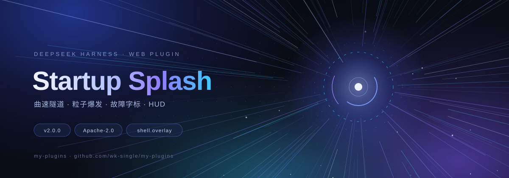

# my-plugins

> DeepSeek Harness 插件集合 · A collection of DeepSeek Harness plugins



每个插件都是可独立安装的 Harness bundle，统一放在 [`packages/`](packages) 下，版本、变更记录与校验流程各自独立。

## 插件列表

| 插件 | 版本 | 说明 |
| --- | --- | --- |
| [Startup Splash](packages/startup-splash) | 2.0.0 | 全屏曲速隧道、粒子爆发、故障字标与 HUD 的电影感启动序列 |

## 安装

1. 克隆仓库并记下路径：

   ```bash
   git clone https://github.com/wk-single/my-plugins.git
   ```

2. 在 DeepSeek Harness 中以**本地 bundle 目录**安装插件：

   - 让 Harness 助手执行 `plugin_manager install_bundle`，目标为
     `<repo>/packages/startup-splash`；
   - 或在 Harness 的插件管理界面选择该目录（若你的版本提供本地目录安装入口）。

3. 生效后，每次打开或刷新 Web 界面都会播放启动动画。点击任意处、按 `Esc` 可跳过。

> 插件只向 `shell.overlay` 注册一个浮层，不修改 Harness 的其它行为；禁用或卸载后立即恢复。

## 目录结构

```
packages/
  startup-splash/       一个可独立安装的 Harness bundle
    package.json        dsh.bundle / dsh.client 清单
    cordis.patch.yml    Loader 行
    index.js            Host 半侧
    client.js           Client 半侧（动画与 slot 注册）
    locale/             插件管理器显示文案（en / zh）
    icon.svg            插件图标
docs/
  preview.svg           仓库头图
scripts/
  validate.mjs          清单与结构校验
```

## 开发约定

**版本**

- 每个插件独立遵循 [SemVer](https://semver.org/)；破坏性变更升主版本。
- 发布时打 tag：`<plugin>-v<version>`，例如 `startup-splash-v2.0.0`。
- 变更写入根目录 [CHANGELOG.md](CHANGELOG.md)（Keep a Changelog 格式）。

**提交**

- 使用 [Conventional Commits](https://www.conventionalcommits.org/)：
  `feat(startup-splash): ...`、`fix(...)`、`docs(...)`、`chore(...)`。
- 一个提交只做一件事；提交信息用中文或英文均可，但同一仓库保持一致。

**校验**

- 本地：`npm run validate` 校验清单、导出、locale、图标与工厂 id 一致性。
- `npm run check` 会同时跑清单校验与 JS 语法检查；`scripts/validate.mjs` 可直接接入任意 CI。
- 新增插件：在 `packages/` 下新建目录，补齐清单、patch、locale 与图标，并加入上方表格。

**分支**

- `main` 保持可安装、可回滚；较大的改动走分支与 PR。
- 历史只追加不重写（不使用 force push）。

## 许可证

[Apache License 2.0](LICENSE)。Copyright 2026 wanka.

---

## English

`my-plugins` is a small collection of installable DeepSeek Harness plugins. Each directory under `packages/` is a self-contained Harness bundle with its own manifest, Loader patch, client code, locales and icon.

The first plugin, **Startup Splash**, plays a full-viewport boot sequence (warp starfield, aurora fields, energy core, HUD) whenever the Harness Web UI opens, then fades out. Click or press `Esc` to skip.

Install it by cloning this repository and adding `packages/startup-splash` as a local bundle in Harness. See the package README for details.
