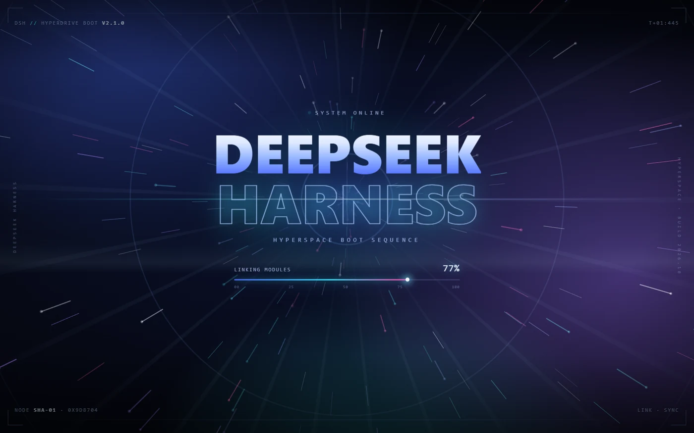

# Startup Splash — DeepSeek Harness 启动动画

一个 Harness Web 界面插件：页面每次启动时先播放一段铺满整个视口的「Supernova」启动序列——奇点充能、临界过载、爆闪 detonation、字标砸场——约 3.6 秒后跃迁淡出，把界面交还给应用。



## 首帧连续

Harness 页面在客户端插件加载前会先渲染一个白色的「Loading plugins...」启动页。本插件在 Host 半侧向 `webserver/index-inject` 推送一条启动引导脚本（桌面端的 `dsh-app://` 页面与浏览器 index 都会消费这条注入）：

- 引导脚本在客户端模块加载前就把同一套深空画面画到页面上，白色启动页被直接盖住；
- 预启动层记录起始时间，客户端 splash 挂载后沿同一条时间线继续（百分比、阶段、画布进度不重置）；
- 客户端 splash 出现后预启动层自动移除，另有 15 秒安全兜底。

## 效果

整屏都在动，不再是中间一小块：

1. **奇点充能（0–1.5s）**：全屏 Canvas 上 170–380 条拖尾光线从四周向中心加速汇聚，中心奇点核逐渐长大变亮，电弧在核周围啪啪炸开；三圈隧道环向内收缩。
2. **临界过载（1.5–2.0s）**：核转为白热并闪烁，汇聚速度翻三倍，红色过载 vignette 在画面边缘脉冲，整帧开始轻微震颤。
3. **爆闪 detonation（2.0s）**：全屏白闪、剧烈震屏、430 块碎片爆散、三道冲击波环、火球与神光束扫过。
4. **巨型字标（2.0–2.6s）**：两行 `DEEPSEEK` / `HARNESS`（实心渐变 + 描边）从爆闪中以模糊收敛、冲击抖动与 RGB 错位故障闪烁砸出。
5. **稳定与跃迁（2.6–3.6s）**：余烬在余光中漂移，读数到 100%；3.6s 时一切拉伸为超空间光线，白闪淡出卸载。
6. **HUD**：四角取景框、上下分隔线、时间码、节点哈希、相位、版本号（v3.0.0）与左右纵向侧标。
7. **启动读数**：四个阶段文案 + 百分比 + 带刻度与发光头部的进度条。

- 点击任意位置、点击「Click / Esc to skip」或按 `Esc` 可立即跳过。
- 跟随系统「减少动态效果」：动画缩短、画面停在爆后静帧、约 1.4 秒后淡出。
- 背景为固定的深空配色，**不随明暗主题变淡**，浅色界面下同样是黑底霓虹效果。
- 文案通过 Harness 语言服务提供英文与简体中文两套。

## 技术说明

- 只有**一个** Canvas，每帧画普通线段与圆点，至多一个径向渐变（火球），没有 `shadowBlur` 或逐粒子渐变；
- CSS 层只做 `transform` / `opacity` 动画，交给合成器；
- 粒子按视口面积自适应数量，窗口缩放时重建；
- 所有样式、`requestAnimationFrame` 与定时器由组件生命周期持有，卸载即清理；
- 预启动层与客户端共用同一条百分比曲线与相位时间轴；客户端读取 `window.__DSH_SPLASH_PREBOOT__` 延续时间线；
- 版本号 `3.0.0` 同时出现在 HUD 左上角与预启动层，便于确认实际加载的版本。

## 安装

在 DeepSeek Harness 中以**本地 bundle 目录**安装本包：

```text
<repo>/packages/startup-splash
```

安装后注册在 `shell.overlay`（框架级浮层，`order: 1000`），显示期间会暂时挡住应用交互，淡出后完全卸载。

## 文件

| 文件 | 作用 |
|---|---|
| `package.json` | 包清单：`dsh.bundle.patch`、`dsh.client`（`immediately: true`）、导出与图标 |
| `cordis.patch.yml` | Loader 行：插入 `startup-splash` 条目 |
| `index.js` | Host 半侧：向 `webserver/index-inject` 推送预启动引导脚本 |
| `client.js` | Client 半侧：`shell.overlay` 注册、Canvas 超新星、光效层与全部动画 |
| `locale/en.json`、`locale/zh.json` | 插件管理器显示标题/描述 |
| `icon.svg` | 插件图标 |

## 卸载

在设置 → 插件中禁用或移除 `Startup Splash` 即可。
